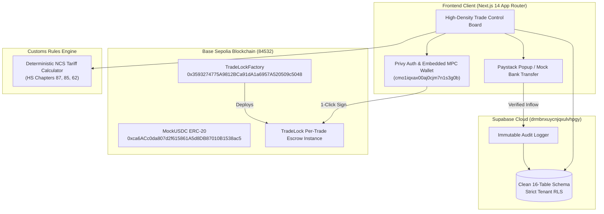

# TradeGuard — Architecture & Design Blueprint
**Document Version:** 2.0 (High-Density Operational Cockpit)  
**Target Market:** Nigerian Importers & International Suppliers  
**Blockchain:** Base Sepolia Testnet  
**Live Contracts:**
- `MockUSDC`: [`0xca6ACc0da807d2f615861A5d8DB87010B1538ac5`](https://sepolia.basescan.org/address/0xca6ACc0da807d2f615861A5d8DB87010B1538ac5)
- `TradeLockFactory`: [`0x3593274775A9812BCa91dA1a6957A520509c5048`](https://sepolia.basescan.org/address/0x3593274775A9812BCa91dA1a6957A520509c5048)

---

## 1. Executive Summary & Design Vision

TradeGuard eliminates payment fraud, delivery disputes, and landed-cost uncertainty in cross-border trade between Nigerian buyers and international exporters. 

### Core Design Philosophy: "Maritime Cargo Terminal"
Instead of generic SaaS marketing cards, purple gradients, and walls of conversational text, TradeGuard operates as a **high-density Financial & Logistics Cockpit** inspired by Bloomberg Terminals, Flexport, and Wise Business:

1. **Utility-First Information Architecture**: Zero marketing filler. Every component represents actionable financial data, contractual milestones, or live blockchain/fiat status.
2. **Balanced Enterprise Density**: Clean borders, high-contrast monospace figures for currencies and hashes, visible state chips, and spacious readable forms.
3. **Radical Simplicity for Trade Creation**: In accordance with user feedback, agreement drafting is stripped of convoluted questionnaires and simplified to a **standard commercial invoice** format (Product, Quantity, Total Price, Counterparty Email).
4. **Split-Panel Operational Control**: The primary trade view operates as a single command cockpit dividing **Local Fiat Tracking (60%)** from **Smart Contract Escrow (40%)**, pinned above a live **Immutable Audit Stream (100%)**.

---

## 2. Design System: "Maritime Cargo Terminal"

```
Palette Roles:
├── Deep Maritime Navy (#0B2545)  -> Primary brand, active control states, header rail
├── Cargo Amber (#D97706, #F59E0B) -> Escrow hold status, inspection caution, action required
├── Settlement Emerald (#059669)  -> Verified payment, on-chain lock, release authorized
├── Dispute Rose (#E11D48)        -> Frozen funds, active disputes, critical alerts
├── Terminal Slate (#1E293B)      -> High-contrast headings, borders (#E2E8F0), body (#334155)
└── Crisp Canvas (#F8FAFC)        -> Clean neutral background, cards (#FFFFFF)
```

### Typography Hierarchy
- **Primary Interface**: Inter / Plus Jakarta Sans — Crisp, legible at small UI sizes (11px–13px table cells, 14px labels).
- **Financial & Cryptographic Figures**: `JetBrains Mono` / `SF Mono` — Applied to all currency amounts (`$7,500.00`, `₦12,375,000`), HS codes (`8708.30.00`), wallet addresses (`0x3Ae...dEc4`), and timestamps.
- **Copy Restraint**: Sentences are capped at 1 line. Explanations are replaced with explicit numeric breakdowns and status tags.

---

## 3. Screen Inventory & Wireframe Blueprint

### 🧭 Global Persistent Header & Control Rail
```
==================================================================================================
[ TG ] TradeGuard Hub           Benchmark Rate: $1 = ₦1,650 NGN       [ Base Sepolia: 0x3Ae...dEc4 ]
==================================================================================================
 📑 1. AI Assessment   |
 🤝 2. Agreements      |  [ ACTIVE VIEWPORT ]
 🔒 3. Escrow Cockpit  |
 📦 4. Shipments       |
 🚨 5. Disputes        |
 ⚙️ 6. System Audit    |
-----------------------+
```
- **Top Header**: Brand mark, live benchmark NGN/USD ticker, Base Sepolia network pulse, and Privy embedded wallet login/logout pill.
- **Left Navigation Strip**: Vertical icon + text rail for seamless switching between modules.

---

### SCREEN 1: Trade Control Board (`/trades/[id]`) — The Core Operational Cockpit
The primary operational dashboard for any ongoing transaction:

```
+------------------------------------------------------------------------------------------------+
| TRADE CONTROL BOARD: #TG-2026-0849 (500 Sets Ceramic Brake Pads)                               |
| Counterparty: Wei Zhang (Shenzhen Precision Machinery) | Terms: CIF Apapa Port | Value: $7,500  |
+------------------------------------------------------------------------------------------------+
| PIPELINE STATUS:                                                                               |
| [✓] 1. AI Audit  ==>  [✓] 2. Invoice Signed  ==>  [●] 3. Fund Escrow  ==> [ ] 4. Shipped       |
|                                                     ==> [ ] 5. Inspected  ==> [ ] 6. Released  |
+---------------------------------------------------------------+--------------------------------+
| LEFT PANEL (60% Width): LOCAL FIAT PAYMENT TRACKING           | RIGHT PANEL (40% Width):       |
| Mode: [● Virtual Bank Transfer]  [○ Paystack Inline Checkout] | BASE SEPOLIA SMART CONTRACT    |
|                                                               |                                |
| Bank Name:       Providus Bank / TradeGuard Virtual           | Contract:    TradeLock #0849   |
| Account Number:  9912048591 (Click to Copy)                   | Factory:     0x3593...5048     |
| Beneficiary:     TradeGuard Escrow FBO Lagos Auto             | Target:      7,500.00 mUSDC    |
| Payable Amount:  ₦12,375,000 NGN (Rate: ₦1,650/$)             |                                |
| Reference:       TG-PAY-2026-0849                             | [ TRANSACTION CHECKS ]         |
|                                                               | Allowance:   Approved ✓        |
| [ BUTTON: SIMULATE NGN INFLOW ]  [ BUTTON: LAUNCH PAYSTACK ]  | Privy State: Ready to Sign     |
|                                                               |                                |
| Status: 🟢 PAYMENT VERIFIED (MOCK HOOK CONFIRMED)             | [ BUTTON: TRIGGER WALLET SIGN ]|
|                                                               | Status: 🟡 AWAITING ON-CHAIN   |
+---------------------------------------------------------------+--------------------------------+
| BOTTOM PANEL (100% Full Width): IMMUTABLE LOGS & REALSIGN AUDIT TIMELINE                       |
| • [21:16:40] Smart contract deployed on Base Sepolia (0x3593274775A9812BCa91dA1a6957A520509c)   |
| • [21:10:12] AI Engine verified Customs Duty Schedule (HS: 8708.30.00, SONCAP Mandatory)       |
| • [20:45:00] Supplier accepted commercial invoice terms via secure invite link                |
+------------------------------------------------------------------------------------------------+
```

---

### SCREEN 2: Commercial Invoice Trade Creator (`/trades/new`)
*Per user directive: Scrap all complex multi-step questionnaires. Clean, single-page invoice layout.*

```
+------------------------------------------------------------------------------------------------+
| CREATE TRADE AGREEMENT (COMMERCIAL INVOICE)                                                    |
+------------------------------------------------------------------------------------------------+
| 1. PARTIES                                                                                     |
| Counterparty Email:  [ supplier@shenzhentrade.cn                                            ]  |
| Company / Contact:   [ Shenzhen Precision Machinery Co.                                     ]  |
|                                                                                                |
| 2. CARGO SPECIFICATION                                                                         |
| Description:         [ 500 Sets Ceramic Brake Pads for Toyota Hilux 2018-2023               ]  |
| Quantity:            [ 500               ]   Unit: [ sets                                   ]  |
| Total Amount ($):    [ 7500.00           ]   Asset: USDC (Base Sepolia)                        |
|                                                                                                |
| 3. DELIVERY & INSPECTION                                                                       |
| Delivery Terms:      [ CIF Apapa Port, Lagos, Nigeria                                       ]  |
| Inspection Hold:     [ 7 ] Days (from arrival date before review hold)                         |
| Special Warranty:    [ ISO 9001 and SONCAP batch certification markings required            ]  |
|                                                                                                |
| [ BUTTON: GENERATE INVOICE & SEND INVITATION LINK ]                                            |
+------------------------------------------------------------------------------------------------+
```

---

### SCREEN 3: AI Import Intelligence Terminal (`/assessments`)
Customs duty and landed cost computation tool:
- **Top**: Category tabs (`Automotive Parts`, `Electronics`, `Textiles`).
- **Input Console**: FOB Value, Estimated Freight, Insurance, Description.
- **Statutory NCS Breakdown Sheet**:
  - Matched HS Code with confidence tag (e.g. `8708.30.00` - 92%).
  - Mathematical breakdown: `CIF = FOB + Freight + Insurance`.
  - Statutory rates applied: `Import Duty` (10%), `7% Surcharge`, `1% CISS`, `0.5% ETLS`, `7.5% VAT`.
  - `Total Landed Cost ($ and ₦)`.
  - Regulatory requirements list: `SONCAP certificate mandatory`, `Form M required`.
- **Action**: `[ DRAFT AGREEMENT FROM THIS INVOICE ]` (auto-populates Screen 2).

---

### SCREEN 4: Cargo Shipment Portal (`/trades/[id]/shipment`)
Dedicated sub-page for fulfillment and logistics tracking:
- Carrier name, tracking number, container/vessel reference.
- Document upload vault (Bill of Lading, Packing List, Commercial Invoice).
- Supplier action: `[ CONFIRM SHIPMENT DISPATCHED ]` -> Calls `TradeLock.confirmShipment()`.
- Importer view: Dispatched date, estimated port arrival, countdown to 7-day inspection window.

---

### SCREEN 5: Inspection & Dispute Mediation (`/trades/[id]/dispute`)
Dedicated sub-page for inspection review and dispute prevention:
- Active inspection timer countdown (e.g. `05d 14h 22m remaining`).
- Notice: *Inspection expiration freezes funds into `PendingReview` rather than auto-releasing.*
- **Two Primary Action Buttons**:
  1. `[ ACCEPT DELIVERY & RELEASE ESCROW ]`: Importer confirms cargo integrity; signs on-chain release to supplier.
  2. `[ RAISE DISPUTE & FREEZE ESCROW ]`: Importer submits discrepancy details and defect photos; calls `TradeLock.raiseDispute()`, immediately locking the smart contract against withdrawal.

---

### SCREEN 6: Supplier Clean Invitation Portal (`/invite/[token]`)
Minimalist invitation gateway for foreign suppliers:
- Displays commercial terms and guaranteed escrow deposit amount.
- Zero upfront Web3 onboarding: Supplier signs in with 1-click email OTP via Privy.
- Action: `[ ACCEPT INVOICE & ACTIVATE ESCROW ]`.

---

## 4. End-to-End System Architecture



---

## 5. Step-by-Step Implementation Roadmap

| Step | Scope | Key Deliverables |
|---|---|---|
| **Step 1** | **Global Control Rail & Ticker** | Build the persistent top bar (`Benchmark: $1 = ₦1,650 NGN`, Base Sepolia pulse, Privy wallet chip) and left icon navigation strip. |
| **Step 2** | **Trade Control Board (`/trades/[id]`)** | Implement the 60/40 Split Cockpit: Left Panel (Fiat Tracking + Bank/Paystack simulation) and Right Panel (Base Sepolia TradeLock status + Privy signing). Add the bottom 100% audit log. |
| **Step 3** | **Ultra-Simple Invoice Creator (`/trades/new`)** | Rebuild agreement creation into a concise, 1-page commercial invoice form without redundant wizard steps. |
| **Step 4** | **Customs Intelligence Terminal (`/assessments`)** | Streamline the import calculator into an efficient tariff lookup sheet with 1-click invoice creation. |
| **Step 5** | **Shipments & Disputes Sub-Pages** | Build `/trades/[id]/shipment` (carrier waybills & BOL uploads) and `/trades/[id]/dispute` (7-day countdown, Accept & Release, Dispute & Freeze). |
| **Step 6** | **Live End-to-End Verification** | Execute live flow: Draft Invoice → Accept via Token Link → Simulate NGN Funding → Sign On-Chain Lock on Base Sepolia → Confirm Shipment → Accept & Release. |

---

## 6. Brainstorming & Review Checklist

- [ ] Does the **Maritime Cargo Terminal** palette (Deep Navy, Cargo Amber, Slate) provide the appropriate institutional gravitas?
- [ ] Is the **simple commercial invoice** format for trade creation fast enough for real importers?
- [ ] Does the **60/40 Split Control Board** cleanly demonstrate both fiat settlement and smart-contract escrow simultaneously?
- [ ] Are all live Base Sepolia contract addresses integrated seamlessly?

